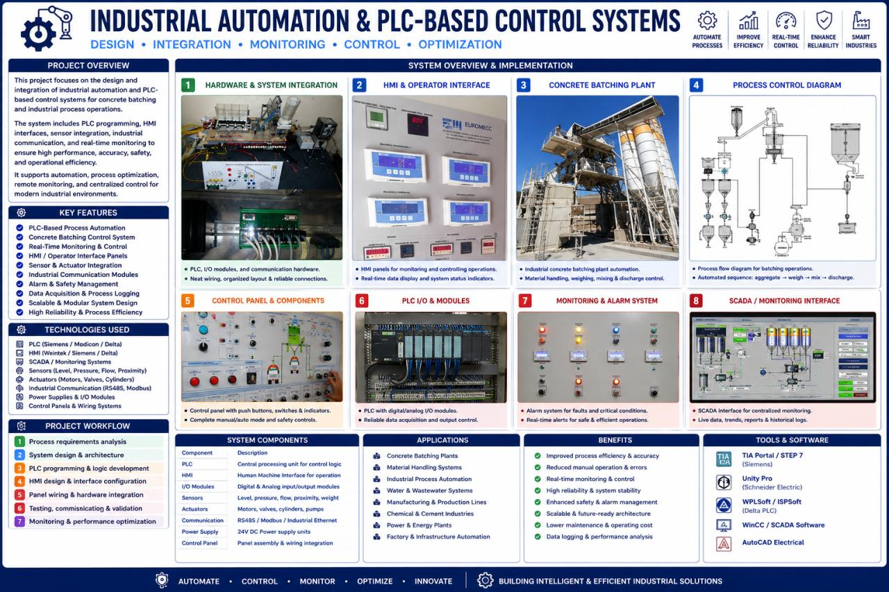
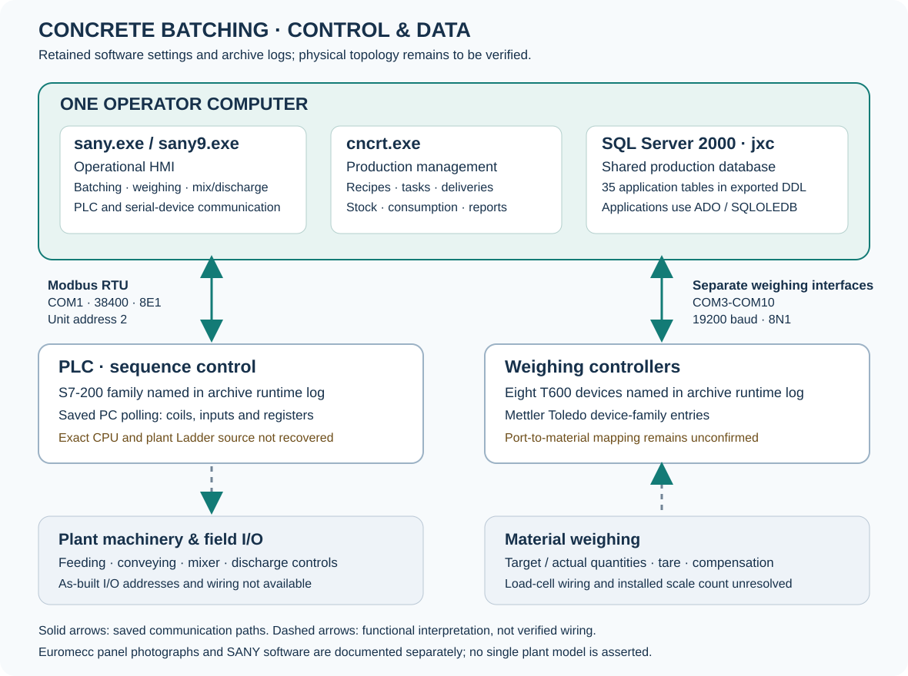

# Industrial Automation & PLC-Based Control Systems

**Central concrete batching plant: PLC control, PC-based HMI, serial weighing and production management.**

[Illustrated case study](https://mahyoub88.github.io/projects/proj-plc-control/) · [Engineering record](docs/ENGINEERING_RECORD.md) · [Profile description](docs/PROFILE_DESCRIPTION.md) · [Project index](docs/PROJECTS.md)

This implemented industrial automation project brings together material handling, weighing, dosing, mixing and discharge with operator control and production records. The technical case study now follows the retained SANY software and database records, alongside the plant and control-panel photographs.

**Author:** Mohammed Mahyoub · [Engineering portfolio](https://mahyoub88.github.io/projects/)

## System at a glance

| Layer | Recorded implementation |
|---|---|
| Operator workstation | One computer runs the operator application, production-management application and database |
| Operational HMI | `sany.exe` / `sany9.exe`: batching screen, weighing and dosing settings, automatic/manual operation, mixing and discharge controls |
| Production management | `cncrt.exe`: recipes, tasks, orders, deliveries, stock, material consumption and production reports |
| Data storage | Microsoft SQL Server 2000, database `jxc`; the exported schema contains 35 application tables |
| PC-to-PLC communication | Modbus RTU on COM1; saved configuration: 38400 baud, 8E1, unit address 2 |
| Weighing communication | Eight serial ports, COM3-COM10, saved at 19200 baud, 8N1 |
| Controller-family evidence | An archived Controx2000 runtime log names one Siemens S7-200 device and eight Mettler Toledo T600 devices; the exact CPU and physical channel assignments remain unconfirmed |

The PLC path and weighing paths are separate in the saved PC configuration. This is a PC-based operator interface: the retained evidence does not establish a separate modern HMI panel, an Ethernet supervisory network or a WinCC installation for this plant.

## How the applications work together

1. **Plan production.** The operator maintains recipes, tasks and deliveries in the production-management software. Material targets and actual quantities are recorded separately.
2. **Configure the batch.** The operational HMI exposes target quantity, cycle count, automatic/manual selection, tare, coarse-feed and in-flight compensation settings.
3. **Coordinate dosing and weighing.** The PC exchanges commands and status with the PLC over Modbus RTU and has separate serial connections configured for weighing devices.
4. **Mix and discharge.** The HMI exposes mixing timers, charge/discharge pause, discharge inhibition and mixer controls. The full PLC state machine is not available in the retained archive.
5. **Record production.** The shared database supports planned-versus-actual material quantities, batch records, deliveries, alarms, operator logs and reporting.

This sequence explains the available controls and records. It is a functional reconstruction, not a recovered Ladder program or a verified safety sequence.

## Weighing and material control

The application and schema distinguish cement, fly ash, mineral powder, powder additive, two liquid additives, aggregate fractions, sand and water. The weighing workflow includes target values, measured values, tolerance settings, tare and compensation for material still in transit after a feeder closes.

| Record | Engineering purpose |
|---|---|
| `recipe` | Material targets and recipe parameters |
| `manufacture` | Planned and actual material quantities for a batch |
| `Task`, `Orders`, `OrderDetail` | Production tasks and order information |
| `OutMaster` | Delivery records |
| `exactitude`, `fall` | Weighing tolerance and in-flight compensation settings |
| `adjcfg` | Mix-ratio adjustments |
| `Alarm`, `LogInfo` | Alarm and activity records |

The eight logged T600 device entries and eight configured weighing ports are consistent with a multi-channel weighing arrangement. Their one-to-one correspondence, scale assignments and load-cell wiring have not been established.

## Plant equipment and operator controls

The retained interfaces cover aggregate bins and conveying, powder silos and feeding, water and additive dosing, mixer operation and discharge. The documented control-panel photographs include manual/automatic selection, weighing indicators, compressor and filter controls, emergency stop and alarm resets.

The physical panels carry **EUROMECC** labels, while the retained PC software is **SANY**. Bin and silo counts also differ between the panel photographs and the software mimic. The case study preserves that distinction; it does not assign a single verified plant model or capacity from the software-folder name.

## What the records establish

- PC applications and database architecture, including the separate operational and production-management roles.
- Saved Modbus and serial communication settings.
- The exported 35-table database schema and the planned/actual weighing record structure.
- S7-200 and T600 device-family names in the archived Controx runtime log.
- Operator functions visible in the retained application forms and control-panel photographs.

## Items still requiring plant records

The exact PLC CPU/order number, plant Ladder source, as-built I/O schedule, terminal list, electrical drawings, drive models, load-cell count, weighing-controller material mapping and original plant Controx project have not been recovered. The Controx installation includes demo projects; its runtime log alone does not establish that Controx was the production front end for the reviewed SANY applications.

The [engineering record](docs/ENGINEERING_RECORD.md) separates direct archive findings, interpretations and general engineering examples. Project photographs and legacy application records document the industrial context; they do not independently establish authorship of every OEM component or program.

## Visual documentation and learning references

The original poster and [cropped source gallery](img/gallery/) remain available. The following older figures explain common batching-plant engineering patterns. Their PLC brands, addresses, Ethernet links, analog signals, alarm priorities and commissioning stages are **illustrative examples**, not the recovered configuration of this plant.

| Figure | Reference topic |
|---|---|
| [Control layers](img/01_control_architecture.svg) | Generic field/control/supervision architecture |
| [Batching sequence](img/02_batching_sequence.svg) | Conceptual dose, weigh, mix and discharge sequence |
| [Project workflow](img/03_project_workflow.svg) | General engineering lifecycle |
| [I/O and wiring](img/04_io_and_field_wiring.svg) | Example signal types and terminal practices |
| [Weighing](img/05_weighing_control.svg) | Coarse/fine feeding, settling and in-flight compensation |
| [Ladder example](img/06_ladder_logic_mixer.svg) | Teaching example for motor start/stop and feedback |
| [Network example](img/07_communication_network.svg) | Generic Ethernet/RS485 arrangement |
| [Alarms](img/08_alarm_management.svg) | Example alarm lifecycle and priorities |
| [Commissioning](img/09_testing_commissioning.svg) | General inspection and verification stages |

## Technologies documented

PLC-based batching control · PC-based HMI · SANY operator software · Modbus RTU · Serial weighing interfaces · SQL Server 2000 · ADO/SQLOLEDB · Recipe and production data · Weighing compensation · Fault investigation · Legacy industrial-system documentation

Siemens S7-200 and Mettler Toledo T600 are identified in archive logs with the qualification above. STEP 7-MicroWIN was present in the archived workstation environment; no plant program was recovered. TIA Portal, WinCC, Modicon, Delta and other modern platforms are not presented here as verified project technologies.

## Source handling

Public documentation contains a technical summary and explanatory figures. Proprietary executables, complete databases, customer/order rows, operator details and account data are not distributed in this repository. No new production measurements, performance improvements, FAT/SAT results or safety certifications are claimed.

## Related work

- [PIC-Based Equipment Room Monitoring & Control System](https://github.com/Mahyoub88/embedded-iot-automation)
- [Original PIC EEPROM implementation archive](https://github.com/Mahyoub88/eeprom-data-storage-pic)
- [All engineering case studies](https://mahyoub88.github.io/projects/)
