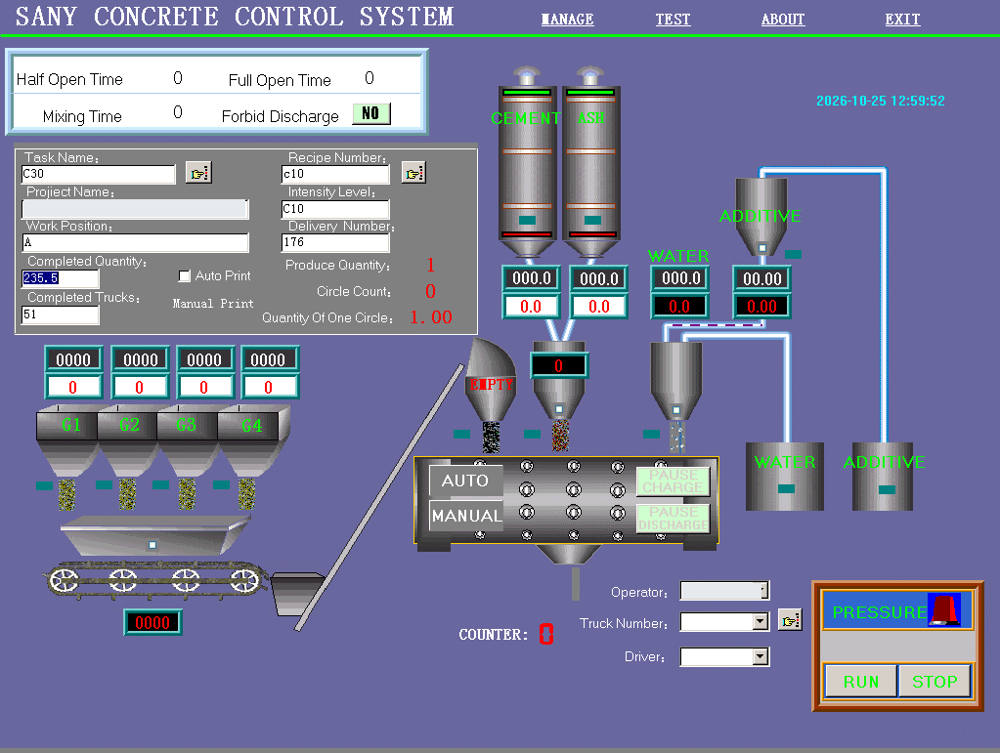
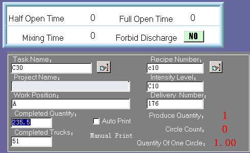
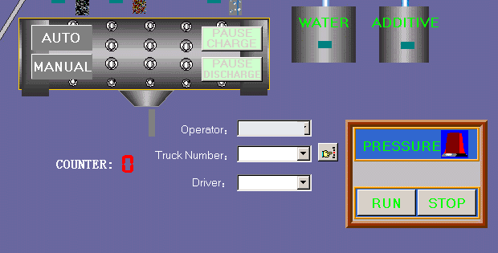
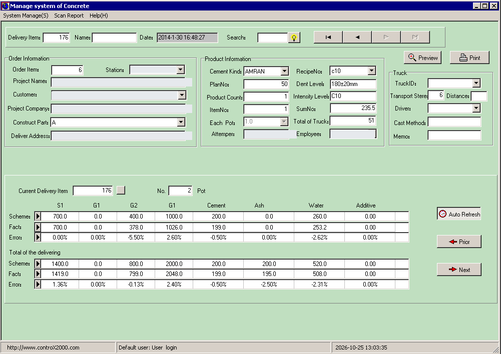
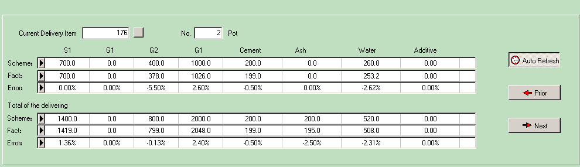
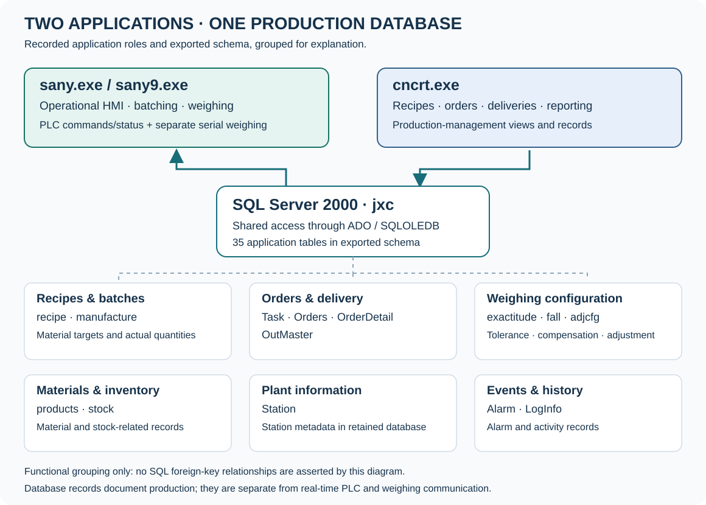

# Software Interfaces — SANY, CNCRT & jxc

[Illustrated case study](https://mahyoub88.github.io/projects/proj-plc-control/#software-interfaces) · [Project overview](../README.md)

Original supplied screenshots, explanatory crops and a separately labelled data diagram. Customer, site and operator identifiers are masked in the published copies. Interface controls and displayed material values are retained. The source screenshots remain unchanged in the private source set.

## 1. SANY: operational HMI

This original supplied screenshot shows the SANY CONCRETE CONTROL SYSTEM operational interface. It is an archived application display, not current plant telemetry. Names and site-identifying fields have been masked; the controls and process readings are preserved.

| Screen element | What it shows or controls | المعنى بالعربية |
|---|---|---|
| MANAGE / TEST / ABOUT / EXIT | Visible application menu entries; their complete actions are not shown in this screenshot. | الإدارة، الاختبار، معلومات البرنامج والخروج |
| Task Name / Recipe Number / Intensity Level | Production-task and recipe/strength-grade context. Recipe identifiers and strength-grade fields are distinct. | المهمة، رقم الوصفة ودرجة المقاومة |
| Project Name / Work Position / Delivery Number | Project/work location and delivery context; identifying project text is masked. | بيانات المشروع ومكان الصب والتسليم |
| Completed Quantity / Completed Trucks | Stored production progress counters, not a measurement of present plant throughput. | الكمية المنجزة وعدد الشاحنات |
| Produce Quantity / Circle Count / Quantity Of One Circle | Job quantity and batching-cycle settings/status displayed by this application. Confirm units and scaling from its configuration. | كمية الإنتاج وعدد الدورات وكمية الدفعة |
| G1–G4, belt and inclined conveyor | Four drawn aggregate bins and the conveying path in this software mimic. These are not a verified installed-bin schedule. | تمثيل حاويات الركام ومسار النقل |
| CEMENT / ASH / WATER / ADDITIVE | Powder, water and admixture paths and numeric displays. Their exact physical channel assignments remain unresolved. | مسارات الأسمنت والرماد والماء والإضافات |
| Paired numeric readouts | Separate displays appear at material stations. Exact tags/scaling require the original communication and weighing configuration. | شاشات رقمية تحتاج ربطًا موثّقًا بالمتغيرات |
| AUTO / MANUAL | Visible mode controls. The screenshot does not establish every permitted manual action or safety interlock. | التشغيل الآلي واليدوي |
| PAUSE CHARGE / PAUSE DISCHARGE | Visible controls for pausing charging and discharge. | إيقاف التغذية أو التفريغ مؤقتًا |
| RUN / STOP | Operator run/stop commands shown in the HMI. A software STOP is not evidence of a safety-rated emergency stop. | أوامر التشغيل والإيقاف |
| PRESSURE alarm | Pressure-related alarm/indicator area. Alarm state and zero readings in the screenshot do not prove a running, connected plant. | تنبيه الضغط كما ظهر وقت التقاط الصورة |
| COUNTER | Displayed batch/cycle counter area; its exact relation to other cycle fields requires the application configuration. | عداد الدورات الظاهر |
| Operator / Truck Number / Driver | Production/operator context fields; personal names have been masked. | المشغّل والشاحنة والسائق |

## 2. SANY: batch settings and timers

This is a crop of the original screenshot, not a reconstructed interface. Timer values are captured display values; the screenshot alone does not establish their configured units or timing logic.

| Setting | Engineering interpretation | المعنى بالعربية |
|---|---|---|
| Half Open Time / Full Open Time | Visible staged-opening timer labels. The driven mechanism and transition logic require PLC code and drawings. | مؤقتا الفتح الجزئي والكامل |
| Mixing Time | Mixing-duration parameter shown in the interface. | زمن الخلط |
| Forbid Discharge | Discharge-inhibit setting/state. It is an operational function, not proof of a safety circuit. | منع التفريغ |
| Auto Print / Manual Print | Automatic-print selection and manual-print function for production output. | الطباعة التلقائية واليدوية |
| Task / recipe selection buttons | Selection controls beside the task and recipe fields. | اختيار المهمة والوصفة |

## 3. SANY: modes, charging, mixing and discharge

The process graphic places manual/automatic controls near the mixer, with charge/discharge pause buttons and a separate run/stop area. Interpret these controls together with the PLC status and field feedback; the retained screenshot is not a recovered Ladder state machine.

- The PLC communication path is saved as Modbus RTU on COM1, 38400 baud, 8E1, unit address 2.
- The PC separately has eight serial weighing ports configured as COM3–COM10 at 19200 baud, 8N1.
- An archive runtime log separately names S7-200 and T600 device families. It does not prove a one-to-one mapping of logged T600 devices to these ports.
- Motor, gate, valve, pump and conveyor assignments need an as-built I/O list and wiring drawings. The mimic is a functional presentation, not that list.

## 4. CNCRT: production and delivery management

The supplied screen is titled Manage system of Concrete. It combines order context, product/recipe information, truck context, per-pot weighing figures and delivery totals. Its footer contains a Controx2000 website reference; that reference alone does not establish which SCADA runtime controlled the plant.

| Visible group | Purpose | المعنى بالعربية |
|---|---|---|
| System Manage / Scan Report / Help | Top-level administration, reporting and help menus. | إدارة النظام والتقارير والمساعدة |
| Delivery Item / date / search / navigation | Find and move between historical delivery records. | البحث والتنقل في سجلات التسليم |
| Order Information | Order, station, project, customer, company, construction part and delivery-address fields. Identifying text is masked. | معلومات الطلب والمشروع والعميل وموقع التسليم |
| Product Information | Cement kind, recipe number, planned quantity, slump-related field, strength grade, batch settings and production progress. | معلومات الوصفة والمنتج والكميات |
| Truck | Truck identifier, transport-related fields, driver, casting method and memo. | بيانات الشاحنة والنقل والصب |
| Preview / Print | Preview and print the selected production/delivery document. | معاينة المستند وطباعته |
| Current Delivery Item / No. … Pot | Context for the current delivery and the displayed pot/batch record. | رقم التسليم والدفعة المعروضة |
| Total of the delivering | Cumulative planned/actual figures for the selected delivery. | الإجمالي التراكمي للتسليم |
| Auto Refresh / Prior / Next | Refresh and navigate the displayed production records. | تحديث البيانات والتنقل بين السجلات |

## 5. Reading target, actual and error

The upper matrix describes the selected pot; the lower matrix describes delivery totals. A selected pot is not the same thing as the complete delivery. Column captions in this retained build include repeated G1 labels, so a header alone cannot establish the physical material mapping.

| Row or example | Meaning | المعنى بالعربية |
|---|---|---|
| Scheme | The recipe/planned quantity shown for a material. | الوزن المطلوب |
| Fact | The recorded actual quantity. | الوزن الفعلي المسجّل |
| Error | Displayed percentage deviation from the planned quantity. | نسبة الانحراف |
| 400.0 → 378.0 | (378 − 400) / 400 × 100 = −5.50%, matching the displayed example. | أقل من المطلوب بنسبة 5.50% |
| 1000.0 → 1026.0 | (1026 − 1000) / 1000 × 100 = +2.60%, matching the displayed example. | أعلى من المطلوب بنسبة 2.60% |
| Zero planned quantity | A relative percentage is mathematically undefined when the target is zero. The application's displayed 0.00% is not an independently meaningful accuracy result. | لا تُحسب نسبة صحيحة بالقسمة على صفر |
| Historical values | These are retained record values, not newly measured calibration results, current output or evidence of guaranteed accuracy. | قيم تاريخية وليست نتائج معايرة جديدة |

## 6. Other documented application functions

The retained application-form and schema analysis documents the functions below. Only the two original full-screen images above were supplied for this publication; additional forms are listed as documented functions, not represented by invented screenshots.

| Function group | Documented scope | Evidence boundary |
|---|---|---|
| Recipes and tasks | Recipe/task editors, quantity setup and production selection. | Retained application forms and database structure. |
| Weighing setup | Tare/deduct, coarse-feed settings, fall/in-flight compensation and weighing tolerance. | No recovered scale wiring or verified channel-to-material schedule. |
| Plant administration | Station, customer, employee, truck, product and supplier editors. | Private records and identities are not published. |
| Production reporting | Delivery/order queries, day/month reports and material consumption. | A delivery comparison screen is shown; other report layouts are not supplied. |
| Stock and inventory | Raw material, silo/stock, purchases and issue-related screens. | Documented forms; no raw business records distributed. |
| Alarms and activity | Alarm display/report, error table, log browser. | No invented alarm thresholds or safety-priority matrix. |
| User access | Login, user and permission management. | No account lists, passwords or credential screens distributed. |
| Database and printing | Database maintenance, report preview and print setup. | No industrial executable was run or original database modified for this update. |

## 7. jxc: the shared application data layer

This is an explanatory diagram drawn from the recorded application architecture and exported schema. It is not a screenshot from SQL Server. Both applications use the jxc database on the same computer through ADO/SQLOLEDB; the database is separate from the real-time PLC and weighing communication paths.

| Table/group | Role | المعنى بالعربية |
|---|---|---|
| recipe | Recipe/material targets and recipe parameters. | الوصفات والأوزان المطلوبة |
| manufacture | Planned and actual material quantities for batch records. | الأوزان المطلوبة والفعلية للدفعات |
| Task / Orders / OrderDetail | Production tasks and order records. | المهام وأوامر الإنتاج |
| OutMaster | Delivery records. | سجلات التسليم |
| exactitude / fall / adjcfg | Tolerance, in-flight compensation and mix-ratio adjustments. | السماحيات وتعويض السقوط وتعديل الخلطة |
| products / stock | Material/product and stock-related records. | المواد والمخزون |
| Station | Station information. | معلومات المحطة |
| Alarm / LogInfo | Alarm and activity records. | الإنذارات وسجل النشاط |

- The exported DDL contains 35 application tables; the table above is a selected functional index, not the complete schema.
- The export contains 34 primary keys and 29 defaults, with no foreign-key, secondary-index, view, stored-procedure or trigger definitions in that export.
- The diagram groups records by purpose. It does not claim recovered SQL foreign-key links or a verified query/transaction sequence.
- Different retained jxc files represent different database states; file size alone is not proof that two copies have identical data.

## 8. How the complete software workflow fits together

- Maintain the recipe and production task in the management application; keep recipe identity, delivery identity and material targets distinct.
- Select the task/recipe and configure the batch in the operational HMI.
- Exchange operational commands/status with the PLC, while the configured serial weighing interfaces provide the weighing communication path.
- Use the HMI's mixing, charging and discharge functions together with PLC/field status. The exact sequence and interlocks require the missing plant program.
- Record batch quantities and production context in the shared data layer; review per-pot values and cumulative delivery records in the management application.
- Use tolerance and in-flight settings as configured engineering parameters. A displayed parameter does not establish a completed calibration or a measured performance improvement.

## 9. Arabic/English glossary

| Term | المصطلح | Meaning |
|---|---|---|
| HMI | واجهة المشغّل | The software display through which an operator views status and issues commands. |
| PLC | المتحكم المنطقي المبرمج | The industrial controller exchanging process commands and status. |
| Recipe | وصفة الخلطة | The selected material quantities and mix parameters. |
| Batch / Pot | دفعة خلط | One production portion/cycle represented in the application. |
| Delivery | تسليم | A delivery context which can contain more than one batch. |
| Setpoint / Scheme | القيمة المطلوبة | The planned target against which an actual value is compared. |
| Actual / Fact | القيمة الفعلية | A measured or recorded quantity. |
| Tare | التصفير / طرح وزن الوعاء | Accounting for the empty container so the material quantity can be determined. |
| Coarse feed | التغذية الخشنة / السريعة | Initial faster feeding toward the target; the exact mechanism is configuration-dependent. |
| Fine feed | التغذية الدقيقة / البطيئة | A general weighing-control principle; it is not proved by a separate fine-feed button in these screenshots. |
| Fall / in-flight compensation | تعويض المادة الساقطة | Allowing for material still travelling after feed is stopped. |
| Tolerance | سماحية الوزن | The configured permitted deviation around a target. |
| Interlock | شرط السماح / التشابك | A condition that must hold before an action is permitted. |
| Modbus RTU | اتصال مودباص التسلسلي | The saved protocol for the PC-to-PLC link in this archive. |
| SQL database | قاعدة البيانات | Persistent application records, distinct from real-time field wiring. |

## Source and interpretation boundaries

The screenshots show historical interfaces and records. Displayed zeros, timers, a pressure indicator and production figures are captured states; they do not establish a currently connected or safely commissioned plant. The database diagram is an explanatory functional grouping. Exact CPU, I/O addresses, scale assignments, timer units and interlock behavior require original configuration and drawings. No replacement screenshot or hidden application window has been fabricated.
